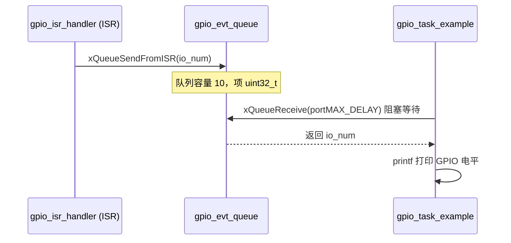

# FreeRTOS 队列（Queue）使用文档

> 基于 `components/freertos/FreeRTOS-Kernel/include/freertos/queue.h`（ESP-IDF v6.0.2 / FreeRTOS Kernel V10.5.1 SMP 修改版）整理
> 使用前提：**必须在包含 `queue.h` 之前先包含 `FreeRTOS.h`**

```c
#include "freertos/FreeRTOS.h"
#include "freertos/queue.h"
```

---

## 1. 概述

队列是 FreeRTOS 中**任务间通信**与**任务/中断间通信**的核心机制：

- 数据**按值拷贝**（item is queued by copy, not by reference）发送和接收
- 支持**阻塞等待**（指定 tick 数，满则等、空则等）
- 提供**ISR 安全版本**（`xxxFromISR`）供中断中使用
- 信号量（Semaphore）、互斥锁（Mutex）底层均基于队列实现
- 支持**队列集（Queue Set）**，可让一个任务同时阻塞监听多个队列/信号量

---

## 2. 关键类型

```c
struct QueueDefinition;            // 队列内部结构（不透明）
typedef struct QueueDefinition * QueueHandle_t;             // 队列句柄
typedef struct QueueDefinition * QueueSetHandle_t;          // 队列集句柄
typedef struct QueueDefinition * QueueSetMemberHandle_t;    // 队列集成员句柄
```

> 三者本质都是 `QueueDefinition*`，可互相转换（如把队列加入队列集时强转为成员）。

---

## 3. API 分类速查表

### 3.1 创建与销毁

| 函数 | 功能 |
|------|------|
| `xQueueCreate(uxQueueLength, uxItemSize)` | **动态创建队列**，返回句柄；失败返回 `NULL`（即 0） |
| `xQueueCreateStatic(uxQueueLength, uxItemSize, pucQueueStorage, pxQueueBuffer)` | 静态创建（无动态内存分配），存储区至少 `长度×项大小` 字节 |
| `xQueueGetStaticBuffers()` | 取回静态队列的数据结构缓冲与存储区指针 |
| `vQueueDelete(xQueue)` | 删除队列，释放存储项的内存 |

> 静态创建所需内存由用户提供，需声明 `StaticQueue_t` 与 `uint8_t` 存储数组，需开启 `configSUPPORT_STATIC_ALLOCATION`。

### 3.2 发送（任务上下文）

| 函数 | 功能 |
|------|------|
| `xQueueSendToFront(xQueue, pvItem, xTicksToWait)` | 插入**队首** |
| `xQueueSendToBack(xQueue, pvItem, xTicksToWait)` | 插入**队尾** |
| `xQueueSend(xQueue, pvItem, xTicksToWait)` | 等价于 `xQueueSendToBack`（向后兼容） |
| `xQueueOverwrite(xQueue, pvItem)` | **仅限长度 1 的队列**，满则覆盖旧值，必定成功 |

返回值：`pdPASS`（成功）或 `errQUEUE_FULL`（队列满且等待超时）。

### 3.3 接收 / 查看（任务上下文）

| 函数 | 功能 |
|------|------|
| `xQueueReceive(xQueue, pvBuffer, xTicksToWait)` | 接收并**移除**队首项，成功返回 `pdTRUE` |
| `xQueuePeek(xQueue, pvBuffer, xTicksToWait)` | 查看队首项但**不移除**，成功返回 `pdTRUE` |

### 3.4 查询

| 函数 | 功能 |
|------|------|
| `uxQueueMessagesWaiting(xQueue)` | 当前队列中的消息数量 |
| `uxQueueSpacesAvailable(xQueue)` | 队列剩余可用空间 |
| `uxQueueMessagesWaitingFromISR(xQueue)` | ISR 中查询消息数量 |
| `xQueueIsQueueEmptyFromISR(xQueue)` | ISR 中判断是否为空 |
| `xQueueIsQueueFullFromISR(xQueue)` | ISR 中判断是否已满 |

### 3.5 ISR 版本（中断中使用）

| 函数 | 功能 |
|------|------|
| `xQueueSendToFrontFromISR(q, item, &pxHigherPriorityTaskWoken)` | 队首插入 |
| `xQueueSendToBackFromISR(q, item, &pxHigherPriorityTaskWoken)` | 队尾插入 |
| `xQueueSendFromISR(q, item, &pxHigherPriorityTaskWoken)` | 等价于 SendToBackFromISR |
| `xQueueOverwriteFromISR(q, item, &pxHigherPriorityTaskWoken)` | 覆盖（长度 1） |
| `xQueueReceiveFromISR(q, pvBuffer, &pxHigherPriorityTaskWoken)` | 接收 |
| `xQueueGiveFromISR(q, &pxHigherPriorityTaskWoken)` | 给信号量专用（不拷贝数据） |

> ⚠️ `pxHigherPriorityTaskWoken` **必须初始化为 `pdFALSE`**；若被置为 `pdTRUE`，应在中断退出前调用 `portYIELD_FROM_ISR()` 请求上下文切换。
> `xQueuePeekFromISR()` 为查看不移除版本。

### 3.6 队列集（Queue Set）

| 函数 | 功能 |
|------|------|
| `xQueueCreateSet(uxEventQueueLength)` | 创建队列集；长度建议等于各成员长度之和（信号量按 1 计） |
| `xQueueAddToSet(member, set)` | 把队列/信号量加入队列集 |
| `xQueueRemoveFromSet(member, set)` | 移除（成员必须为空才能移除） |
| `xQueueSelectFromSet(set, xTicksToWait)` | 阻塞等待任一成员可用，返回该成员句柄，超时返回 `NULL` |

> 从队列集选出成员后，**必须**先 `xQueueSelectFromSet` 再对该成员做 receive/take，不能在未选中时直接操作。
> 见 `FreeRTOS/Source/Demo/Common/Minimal/QueueSet.c` 官方示例。

### 3.7 其他

| 函数 | 功能 |
|------|------|
| `xQueueReset(xQueue)` | 复位队列为空（返回值已废弃，恒为 `pdPASS`） |
| `vQueueAddToRegistry(q, name)` / `vQueueUnregisterQueue(q)` | 注册/注销队列名（供内核调试器查看，需 `configQUEUE_REGISTRY_SIZE > 0`） |
| `pcQueueGetName(q)` | 查询队列注册名 |
| `xQueueCreateMutex()` / `xQueueCreateCountingSemaphore()` 等 | **内部函数**，请改用 `semphr.h` 提供的信号量/互斥 API |

---

## 4. 典型使用流程

### 4.1 任务间通信（动态创建）

```c
QueueHandle_t xQueue;

// 创建能装 10 个 uint32_t 的队列
xQueue = xQueueCreate(10, sizeof(uint32_t));
if (xQueue == NULL) {
    // 创建失败处理
}

// 发送任务
uint32_t val = 42;
xQueueSend(xQueue, &val, portMAX_DELAY);          // 满则一直等
xQueueSendToFront(xQueue, &val, 0);               // 立即返回，不等待

// 接收任务
uint32_t rx;
if (xQueueReceive(xQueue, &rx, pdMS_TO_TICKS(100))) {
    printf("收到: %"PRIu32"\n", rx);
}
```

### 4.2 ISR → 任务（GPIO 示例中的标准写法）

```c
static QueueHandle_t gpio_evt_queue;

// ISR：只做"通知"，不阻塞
static void IRAM_ATTR gpio_isr_handler(void* arg)
{
    uint32_t gpio_num = (uint32_t) arg;
    BaseType_t xHigherPriorityTaskWoken = pdFALSE;
    xQueueSendFromISR(gpio_evt_queue, &gpio_num, &xHigherPriorityTaskWoken);
    if (xHigherPriorityTaskWoken == pdTRUE) {
        portYIELD_FROM_ISR();   // 请求切换
    }
}

// 任务：阻塞等待事件
static void gpio_task(void* arg)
{
    uint32_t io_num;
    for (;;) {
        if (xQueueReceive(gpio_evt_queue, &io_num, portMAX_DELAY)) {
            printf("GPIO[%"PRIu32"] level: %d\n", io_num, gpio_get_level(io_num));
        }
    }
}

void app_main(void)
{
    gpio_evt_queue = xQueueCreate(10, sizeof(uint32_t));
    xTaskCreate(gpio_task, "gpio_task", 2048, NULL, 10, NULL);
    gpio_install_isr_service(0);
    gpio_isr_handler_add(GPIO_NUM_4, gpio_isr_handler, (void*) GPIO_NUM_4);
}
```

### 4.3 静态创建

```c
#define QUEUE_LENGTH 10
#define ITEM_SIZE    sizeof(uint32_t)

StaticQueue_t xQueueBuffer;
uint8_t ucQueueStorage[QUEUE_LENGTH * ITEM_SIZE];

QueueHandle_t xQueue = xQueueCreateStatic(QUEUE_LENGTH, ITEM_SIZE,
                                          ucQueueStorage, &xQueueBuffer);
// 静态创建必定成功（除非传 NULL）
```

### 4.4 队列集：同时监听多个队列

```c
QueueSetHandle_t xSet = xQueueCreateSet(2 + 1 + 1);   // 队列长度 2、1 和 1 个信号量
xQueueAddToSet(xQueue1, xSet);
xQueueAddToSet(xQueue2, xSet);
xSemaphoreAddToSet(xSem, xSet);   // 信号量也可加入

// 阻塞等待任一成员就绪
QueueSetMemberHandle_t ready = xQueueSelectFromSet(xSet, portMAX_DELAY);
if (ready == (QueueSetMemberHandle_t)xQueue1) {
    xQueueReceive(xQueue1, &rx, 0);
} else if (ready == (QueueSetMemberHandle_t)xSem) {
    xSemaphoreTake(xSem, 0);
}
```

---

## 5. 本项目中的使用对照

本项目 `main/gpio_example_main.c` 使用了队列完成 **GPIO 中断 → 任务** 的通信：



关键代码：

```c
static QueueHandle_t gpio_evt_queue = NULL;              // 全局队列句柄

// 创建：容量 10，每项一个 uint32_t 引脚号
gpio_evt_queue = xQueueCreate(10, sizeof(uint32_t));

// ISR 发送
xQueueSendFromISR(gpio_evt_queue, &gpio_num, NULL);

// 任务接收
xQueueReceive(gpio_evt_queue, &io_num, portMAX_DELAY)
```

---

## 6. 注意事项

1. **按值拷贝**：队列中存的是数据的副本，发送后原变量可复用；项太大时建议改存**指针**。
2. **阻塞时间单位是 tick**：用 `pdMS_TO_TICKS(ms)` 或 `portTICK_PERIOD_MS` 换算；`0` 表示不等待立即返回，`portMAX_DELAY` 表示一直等。
3. **ISR 中禁止阻塞**：ISR 里只能调用 `xxxFromISR` 系列，且 `xTicksToWait` 参数固定为 `0`。
4. **`pxHigherPriorityTaskWoken` 必须初始化为 `pdFALSE`**，返回 `pdTRUE` 时应在中断退出前 `portYIELD_FROM_ISR()`。
5. **`xQueueOverwrite` 只能用于长度 1 的队列**，否则触发 `configASSERT`。
6. **静态创建**：存储数组大小必须 ≥ `uxQueueLength × uxItemSize`，且需 `configSUPPORT_STATIC_ALLOCATION=1`。
7. **信号量/互斥锁**请用 `freertos/semphr.h` 的 API，不要直接调用 `xQueueCreateMutex` 等内部函数。
8. **队列集注意**：成员被选中后才能操作；互斥锁加入队列集不会发生优先级继承；每空位额外占 4 字节 RAM。
9. **队列删除后**句柄失效，任何对已删除队列的访问都是未定义行为。
10. 通过 `vQueueAddToRegistry` 注册后，可用内核调试器（如 SystemView）查看队列内容。
