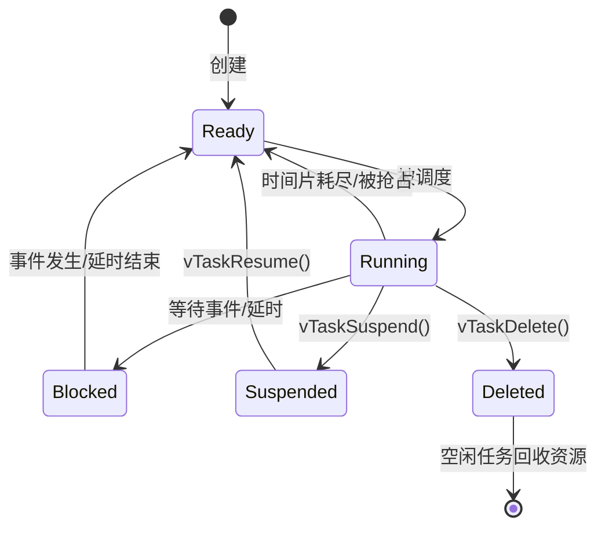

# FreeRTOS Task（任务）使用文档

> 适用环境：ESP-IDF v6.0.2（FreeRTOS Kernel V10.5.1，ESP-IDF SMP 修改版）
> 芯片：ESP32-C3（单核，`configNUMBER_OF_CORES = 1`）
> 参考头文件：`components/freertos/FreeRTOS-Kernel/include/freertos/task.h`

---

## 1. 什么是任务（Task）

任务是一段**独立的、永不返回的执行流**（通常是一个无限循环），由 FreeRTOS 调度器负责调度。

- 每个任务有独立的 **栈（Stack）** 和 **任务控制块（TCB）**。
- 每个任务有一个 **优先级（Priority）**，数值越大优先级越高（`tskIDLE_PRIORITY = 0` 为最低，即空闲任务优先级）。
- 任务之间通过队列、信号量、事件组、任务通知等机制同步/通信。

> ⚠️ **ESP-IDF 特别注意**：在 ESP-IDF 中，`xTaskCreate` 的栈大小 `usStackDepth` 的单位是 **字节（Bytes）**，而原生 FreeRTOS 中是“字（words）”。见 `task.h` 注释：*“The size of the task stack specified as the NUMBER OF BYTES. Note that this differs from vanilla FreeRTOS.”*

---

## 2. 任务的 5 种状态



| 状态 | 枚举值 | 说明 |
|------|--------|------|
| 运行态 | `eRunning` | 正在占用 CPU |
| 就绪态 | `eReady` | 可运行，等待调度器分配 CPU |
| 阻塞态 | `eBlocked` | 等待某事件或延时，**不消耗 CPU** |
| 挂起态 | `eSuspended` | 被挂起，必须调用 `vTaskResume()` 恢复 |
| 删除态 | `eDeleted` | 已被删除，TCB 尚未被空闲任务释放 |

---

## 3. 创建任务

### 3.1 动态创建（推荐）

```c
BaseType_t xTaskCreate(
    TaskFunction_t pxTaskCode,        // 任务函数，永不返回
    const char * const pcName,        // 任务名（仅用于调试）
    const configSTACK_DEPTH_TYPE usStackDepth,  // 栈大小【字节】
    void * const pvParameters,        // 传给任务的参数
    UBaseType_t uxPriority,           // 优先级 (0 ~ configMAX_PRIORITIES-1)
    TaskHandle_t * const pxCreatedTask); // 任务句柄（可传 NULL）
```

返回值：`pdPASS` 成功；`errCOULD_NOT_ALLOCATE_REQUIRED_MEMORY` 内存不足。

**示例（本项目）：**

```c
xTaskCreate(gpio_task, "GPIO Task", 2048, NULL, 5, NULL);
```

**任务函数模板（永不返回）：**

```c
void my_task(void *arg)
{
    // 初始化...

    for (;;) {
        // 任务主体逻辑
        vTaskDelay(pdMS_TO_TICKS(100));   // 让出 CPU，避免占满
    }
}
```

### 3.2 固定核心创建

ESP-IDF 提供 `xTaskCreatePinnedToCore()`，可把任务绑定到指定核（多核芯片才有多核可选）。

```c
BaseType_t xTaskCreatePinnedToCore(
    TaskFunction_t pxTaskCode,
    const char * const pcName,
    const configSTACK_DEPTH_TYPE usStackDepth,
    void * const pvParameters,
    UBaseType_t uxPriority,
    TaskHandle_t * const pxCreatedTask,
    const BaseType_t xCoreID);   // 0 或 1，或 tskNO_AFFINITY(不绑定)
```

> ESP32-C3 是单核，`xCoreID` 只能为 `0`。`xTaskCreate()` 在 ESP-IDF 中实际就是调用 `xTaskCreatePinnedToCore(..., tskNO_AFFINITY)`。

### 3.3 静态创建

当 `configSUPPORT_STATIC_ALLOCATION == 1` 时可用，栈和 TCB 由用户提供，不占用堆内存：

```c
StaticTask_t xTaskBuffer;
StackType_t xStack[ 2048 / sizeof(StackType_t) ];  // ESP32: StackType_t = uint32_t，即 4 字节/字

TaskHandle_t h = xTaskCreateStatic(
    my_task, "Static", sizeof(xStack), NULL,
    tskIDLE_PRIORITY, xStack, &xTaskBuffer);
```

---

## 4. 任务控制 API

### 4.1 延时

| 函数 | 说明 |
|------|------|
| `vTaskDelay(xTicksToDelay)` | 相对延时：阻塞 N 个 tick 后回到就绪态（时间可能漂移） |
| `xTaskDelayUntil(&pxLastWake, xIncrement)` | 绝对延时：**固定周期执行**，适合周期任务 |

```c
// 相对延时：周期可能漂移
vTaskDelay(pdMS_TO_TICKS(100));

// 绝对延时：固定 100ms 周期
TickType_t last = xTaskGetTickCount();
for (;;) {
    // 任务主体
    xTaskDelayUntil(&last, pdMS_TO_TICKS(100));
}
```

### 4.2 挂起 / 恢复

| 函数 | 说明 |
|------|------|
| `vTaskSuspend(xTask)` | 挂起任务（传 `NULL` 挂起自己），挂起任务**不消耗 CPU** |
| `vTaskResume(xTask)` | 恢复被挂起的任务 |
| `xTaskResumeFromISR(xTask)` | 从中断中恢复任务，返回 `pdTRUE` 表示需要上下文切换 |

> ⚠️ 挂起/恢复非累积：连续调用两次 `vTaskSuspend`，只需一次 `vTaskResume` 即可恢复。

### 4.3 优先级

| 函数 | 说明 |
|------|------|
| `uxTaskPriorityGet(xTask)` | 获取优先级（`NULL` = 当前任务） |
| `vTaskPrioritySet(xTask, uxNewPriority)` | 设置优先级 |

### 4.4 删除任务

```c
vTaskDelete(xTaskToDelete);   // 传 NULL 删除自己
```

- 被删除任务的内存由**空闲任务（idle task）**回收，因此不能长时间饿死空闲任务。
- 删除前应释放任务自己申请的内存（`free()`）。

---

## 5. 任务查询 / 调试 API

| 函数 | 用途 |
|------|------|
| `xTaskGetTickCount()` | 获取当前 tick 计数 |
| `xTaskGetCurrentTaskHandle()` | 当前任务句柄 |
| `pcTaskGetName(xTask)` | 获取任务名 |
| `xTaskGetHandle("name")` | 按名字查句柄（需 `INCLUDE_xTaskGetHandle`） |
| `uxTaskGetNumberOfTasks()` | 系统中任务总数 |
| `uxTaskGetStackHighWaterMark(xTask)` | 栈剩余高水位（**字节**），越接近 0 越危险 |
| `eTaskGetState(xTask)` | 查询任务状态 |
| `vTaskList(buffer)` | 输出所有任务状态表格（需 `configUSE_TRACE_FACILITY`） |
| `uxTaskGetSystemState(...)` | 批量获取系统任务状态 |

**栈溢出排查：**

```c
// 在任务某处打印栈剩余空间
printf("stack free: %u\n", (unsigned)uxTaskGetStackHighWaterMark(NULL));
```

若返回值接近 0，说明栈大小不足，应调大 `xTaskCreate` 中的 `usStackDepth`。

---

## 6. 任务通知（Task Notification）

任务通知是**轻量级、快速**的同步机制，比信号量/队列更省内存（`configUSE_TASK_NOTIFICATIONS = 1` 时可用）。

每个任务有一组 32 位通知值（数组大小由 `configTASK_NOTIFICATION_ARRAY_ENTRIES` 决定，默认 1 个）。

| 函数 | 说明 |
|------|------|
| `xTaskNotify(xTask, ulValue, eAction)` | 发通知（动作见下表） |
| `xTaskNotifyFromISR(...)` | 中断中发通知 |
| `xTaskNotifyGive(xTask)` / `xTaskNotifyGiveFromISR(...)` | 等效“给信号量” |
| `xTaskNotifyWait(clearOnEntry, clearOnExit, &value, ticks)` | 等待通知（等效“取信号量”/等待事件） |
| `ulTaskNotifyTake(clearOnExit, ticks)` | 通知值作为计数/二值信号量来取 |

`eNotifyAction` 动作：

| 动作 | 效果 |
|------|------|
| `eNoAction` | 只发通知不改值 |
| `eSetBits` | 通知值按位 OR `ulValue`（可当事件标志用） |
| `eIncrement` | 通知值 +1（计数信号量） |
| `eSetValueWithOverwrite` | 直接覆盖通知值 |
| `eSetValueWithoutOverwrite` | 无待处理通知时才写入 |

**示例（作二值信号量）：**

```c
// 中断中：通知任务
BaseType_t woken = pdFALSE;
vTaskNotifyGiveFromISR(my_task_handle, &woken);
portYIELD_FROM_ISR(woken);

// 任务中：等待通知，阻塞不耗 CPU
while (ulTaskNotifyTake(pdTRUE, portMAX_DELAY) != 0) {
    // 收到通知，处理事件
}
```

---

## 7. 调度与优先级说明

- 抢占式调度：高优先级任务就绪时立即抢占低优先级任务。
- 相同优先级任务按**时间片轮转**（`configUSE_TIME_SLICING`）。
- **优先级反转**：使用互斥量（Mutex）时内核会自动做优先级继承。
- ESP32-C3 单核：同一时刻只有一个任务在运行。


---

## 8. 中断安全相关

在 ISR 中：
- 使用带 `FromISR` 后缀的 API：`xQueueSendFromISR`、`xTaskNotifyGiveFromISR`、`xTaskResumeFromISR`、`xSemaphoreGiveFromISR` 等。
- 不允许在 ISR 中调用阻塞 API（如 `vTaskDelay`、`xQueueReceive`）。
- 若 `pxHigherPriorityTaskWoken` 返回 `pdTRUE`，应在退出中断时调用 `portYIELD_FROM_ISR(woken)` 触发上下文切换。

---

## 9. 常见问题与注意事项

1. **栈大小单位是字节**（ESP-IDF），任务函数内局部变量、printf、递归都会占用栈。默认可先用 2048~4096，再通过 `uxTaskGetStackHighWaterMark` 校准。
2. **任务函数不能 return**，必须用 `for(;;)` 无限循环；若提前返回会导致崩溃（触发栈溢出钩子）。
3. **传参的生命周期**：`pvParameters` 指向的内存必须存活于任务整个生命周期，不能用栈上局部变量。
4. **优先级范围**：0（`tskIDLE_PRIORITY`）到 `configMAX_PRIORITIES - 1`。
5. **空闲任务不可被饿死**：否则 `vTaskDelete` 释放的内存无法回收。
6. **临界区**：`taskENTER_CRITICAL()` / `taskEXIT_CRITICAL()` 保护共享资源（关中断），但临界区内不能调用阻塞 API。
7. 在 `vTaskSuspendAll()` 挂起调度器期间，不能调用可能触发上下文切换的 API。
8. **调度器启动**：ESP-IDF 中 `app_main` 本身就是由系统创建的一个任务（优先级 1），无需手动调用 `vTaskStartScheduler()`。

---

## 10. 结合本项目的示例解析

当前工程 `main/main.c` 的结构：

```c
void IRAM_ATTR keys_isr_handler(void *arg)   // GPIO 中断回调（ISR 上下文）
{
    uint32_t gpio_num = (uint32_t)arg;
    xQueueSendFromISR(evt_q, &gpio_num, NULL);  // 中断中发队列（FromISR 版本）
}

void gpio_task(void *arg)                    // 任务：队列消费者
{
    uint32_t gpio_num;
    while (1) {
        if (xQueueReceive(evt_q, &gpio_num, portMAX_DELAY)) {  // 阻塞等待，不耗 CPU
            printf("key is %d\n", (int)gpio_num);
        }
    }
}

void app_main(void)
{
    keys_init();
    evt_q = xQueueCreate(10, sizeof(uint32_t));   // 创建队列，容量10，元素4字节
    xTaskCreate(gpio_task, "GPIO Task", 2048, NULL, 5, NULL);  // 创建任务，栈2048字节，优先级5
}
```

**流程：** 按键 GPIO 中断 → `keys_isr_handler`（ISR）→ `xQueueSendFromISR` 入队 → `gpio_task` 从 `xQueueReceive` 解除阻塞 → 打印按键号。

> 该模式即经典的 **“ISR 快速采集 + 任务慢速处理”** 设计：中断只负责入队，耗时处理全部放在任务里，保证中断实时性。

---

## 11. 常用 API 速查表

| 功能 | 函数 |
|------|------|
| 动态创建任务 | `xTaskCreate` |
| 固定核心创建 | `xTaskCreatePinnedToCore` |
| 静态创建任务 | `xTaskCreateStatic` |
| 删除任务 | `vTaskDelete` |
| 相对延时 | `vTaskDelay` |
| 固定周期延时 | `xTaskDelayUntil` |
| 挂起 / 恢复 | `vTaskSuspend` / `vTaskResume` |
| 中断恢复 | `xTaskResumeFromISR` |
| 获取 / 设置优先级 | `uxTaskPriorityGet` / `vTaskPrioritySet` |
| 栈高水位（字节） | `uxTaskGetStackHighWaterMark` |
| 查询状态 | `eTaskGetState` |
| 获取当前任务句柄 | `xTaskGetCurrentTaskHandle` |
| 任务通知 | `xTaskNotify` / `xTaskNotifyGive` / `xTaskNotifyWait` / `ulTaskNotifyTake` |
| 通知（ISR 版） | `xTaskNotifyFromISR` / `vTaskNotifyGiveFromISR` |
| 挂起 / 恢复调度器 | `vTaskSuspendAll` / `xTaskResumeAll` |
| 临界区 | `taskENTER_CRITICAL` / `taskEXIT_CRITICAL` |
