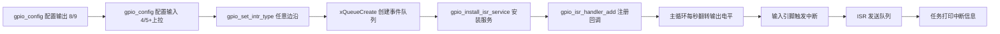

# ESP-IDF GPIO 使用文档

> 基于 `components/esp_driver_gpio/include/driver/gpio.h`（ESP-IDF v6.0.2）整理
> 适用芯片：ESP32 / ESP32-S2 / ESP32-S3 / ESP32-C3 / ESP32-C6 等

---

## 1. 概述

ESP-IDF 的 GPIO 驱动封装了芯片的 IO MUX 与 GPIO 外设，提供：
- 引脚模式配置（输入 / 输出 / 输入输出）
- 内部上拉 / 下拉电阻控制
- 中断检测（上升沿 / 下降沿 / 双边沿 / 电平）
- 电平读写、开漏输出、驱动能力调节
- 低功耗（睡眠保持 / 唤醒）功能

**头文件：**

```c
#include "driver/gpio.h"
```

---

## 2. 关键类型与结构体

### 2.1 配置结构体 `gpio_config_t`

```c
typedef struct {
    uint64_t pin_bit_mask;   // GPIO 引脚位掩码，每一位对应一个 GPIO
    gpio_mode_t mode;        // 输入/输出模式
    gpio_pullup_t pull_up_en;       // 内部上拉使能
    gpio_pulldown_t pull_down_en;   // 内部下拉使能
    gpio_int_type_t intr_type;      // 中断触发类型
#if SOC_GPIO_SUPPORT_PIN_HYS_FILTER
    gpio_hys_ctrl_mode_t hys_ctrl_mode;  // 迟滞滤波（部分芯片支持）
#endif
} gpio_config_t;
```

> 相关枚举定义在 `hal/gpio_types.h`：
> - `gpio_mode_t`：`GPIO_MODE_DISABLE` / `GPIO_MODE_INPUT` / `GPIO_MODE_OUTPUT` / `GPIO_MODE_OUTPUT_OD` / `GPIO_MODE_INPUT_OUTPUT` / `GPIO_MODE_INPUT_OUTPUT_OD`
> - `gpio_int_type_t`：`GPIO_INTR_DISABLE` / `GPIO_INTR_POSEDGE` / `GPIO_INTR_NEGEDGE` / `GPIO_INTR_ANYEDGE` / `GPIO_INTR_LOW_LEVEL` / `GPIO_INTR_HIGH_LEVEL`
> - `gpio_pullup_t` / `gpio_pulldown_t`：`GPIO_PULLUP_ENABLE` / `GPIO_PULLUP_DISABLE` 等

### 2.2 中断回调类型

```c
typedef void (*gpio_isr_t)(void *arg);   // 中断处理函数
typedef intr_handle_t gpio_isr_handle_t; // 中断句柄
```

---

## 3. API 分类速查表

### 3.1 引脚配置

| 函数 | 功能 |
|------|------|
| `gpio_config()` | **最常用**。一次性配置模式、上下拉、中断类型 |
| `gpio_reset_pin()` | 复位引脚为默认状态（GPIO 功能、使能上拉、禁用输入输出） |
| `gpio_set_direction()` | 单独设置方向（输出/输入/输入输出） |
| `gpio_get_io_config()` | 读取某个 IO 的当前配置 |
| `gpio_dump_io_configuration()` | 将 IO 配置打印到控制台（调试用） |

### 3.2 电平读写

| 函数 | 功能 |
|------|------|
| `gpio_set_level(num, level)` | 设置输出电平（0 低 / 1 高），**可在 ISR 中使用** |
| `gpio_get_level(num)` | 读取输入电平，返回 0 或 1 |

### 3.3 上下拉与开漏

| 函数 | 功能 |
|------|------|
| `gpio_pullup_en()` / `gpio_pullup_dis()` | 使能 / 关闭内部上拉 |
| `gpio_pulldown_en()` / `gpio_pulldown_dis()` | 使能 / 关闭内部下拉 |
| `gpio_set_pull_mode()` | 一次设置上下拉组合（`GPIO_PULLUP_ONLY` 等） |
| `gpio_od_enable()` / `gpio_od_disable()` | 使能 / 关闭开漏输出 |
| `gpio_input_enable()` | 使能输入 |
| `gpio_output_enable()` / `gpio_output_disable()` | 使能 / 关闭输出 |

### 3.4 中断

| 函数 | 功能 |
|------|------|
| `gpio_set_intr_type()` | 设置中断触发类型 |
| `gpio_intr_enable()` / `gpio_intr_disable()` | 使能 / 关闭某引脚中断信号（可在 ISR 中用） |
| `gpio_install_isr_service()` | **安装 ISR 服务**（按引脚注册多个回调的前提） |
| `gpio_uninstall_isr_service()` | 卸载 ISR 服务，释放资源 |
| `gpio_isr_handler_add()` / `gpio_isr_handler_remove()` | 为指定引脚添加 / 移除 ISR 回调 |
| `gpio_isr_register()` | 注册**单个全局** GPIO 中断处理函数（与 ISR 服务互斥） |

> ⚠️ `gpio_install_isr_service()` 与 `gpio_isr_register()` **不能同时使用**，二者是两种不同的中断模型。

### 3.5 驱动能力（输出电流）

| 函数 | 功能 |
|------|------|
| `gpio_set_drive_capability()` | 设置引脚驱动能力（`GPIO_DRIVE_CAP_x`） |
| `gpio_get_drive_capability()` | 读取引脚驱动能力 |

### 3.6 引脚状态保持（Hold）

| 函数 | 功能 |
|------|------|
| `gpio_hold_en()` / `gpio_hold_dis()` | 锁存 / 释放某个引脚的当前状态 |
| `gpio_deep_sleep_hold_en()` / `gpio_deep_sleep_hold_dis()` | 深睡眠期间保持所有数字 GPIO 状态 |
| `gpio_force_hold_all()` / `gpio_force_unhold_all()` | 强制保持 / 释放所有 pad 状态（需放 IRAM） |

### 3.7 睡眠与唤醒

| 函数 | 功能 |
|------|------|
| `gpio_wakeup_enable(num, intr_type)` | 使能 GPIO 唤醒（仅支持高/低电平） |
| `gpio_wakeup_disable()` | 关闭 GPIO 唤醒 |
| `gpio_sleep_sel_en()` / `gpio_sleep_sel_dis()` | 使能 / 关闭睡眠自动切换 GPIO 状态 |
| `gpio_sleep_set_direction()` | 设置睡眠时引脚方向 |
| `gpio_sleep_set_pull_mode()` | 设置睡眠时上下拉模式 |
| `gpio_wakeup_enable_on_hp_periph_powerdown_sleep()` | 外设掉电睡眠唤醒（SDK 内部调用，用户一般不用） |

---

## 4. 典型使用流程

### 4.1 输出引脚配置

```c
gpio_config_t io_conf = {};
io_conf.intr_type    = GPIO_INTR_DISABLE;   // 输出不产生中断
io_conf.mode         = GPIO_MODE_OUTPUT;    // 输出模式
io_conf.pin_bit_mask = (1ULL << GPIO_NUM_2); // 选择引脚 GPIO2
io_conf.pull_down_en = GPIO_PULLDOWN_DISABLE;
io_conf.pull_up_en   = GPIO_PULLUP_DISABLE;
gpio_config(&io_conf);

gpio_set_level(GPIO_NUM_2, 1);   // 输出高电平
int level = gpio_get_level(GPIO_NUM_2);  // 读取电平
```

### 4.2 输入引脚 + 中断（推荐：ISR 服务 + 队列）

```c
static QueueHandle_t gpio_evt_queue;

// ISR：尽量只做"通知"，把耗时逻辑放任务里
static void IRAM_ATTR gpio_isr_handler(void* arg)
{
    uint32_t gpio_num = (uint32_t) arg;
    xQueueSendFromISR(gpio_evt_queue, &gpio_num, NULL);
}

// 任务：处理中断事件
static void gpio_task(void* arg)
{
    uint32_t io_num;
    for (;;) {
        if (xQueueReceive(gpio_evt_queue, &io_num, portMAX_DELAY)) {
            printf("GPIO[%"PRIu32"] level: %d\n", io_num, gpio_get_level(io_num));
        }
    }
}

void app_main(void)
{
    // 1. 配置输入引脚：上拉 + 上升沿中断
    gpio_config_t io_conf = {};
    io_conf.intr_type    = GPIO_INTR_POSEDGE;
    io_conf.mode         = GPIO_MODE_INPUT;
    io_conf.pin_bit_mask = (1ULL << GPIO_NUM_4);
    io_conf.pull_up_en   = GPIO_PULLUP_ENABLE;
    gpio_config(&io_conf);

    // 2. 创建队列与任务
    gpio_evt_queue = xQueueCreate(10, sizeof(uint32_t));
    xTaskCreate(gpio_task, "gpio_task", 2048, NULL, 10, NULL);

    // 3. 安装 ISR 服务并按引脚注册回调
    gpio_install_isr_service(0);
    gpio_isr_handler_add(GPIO_NUM_4, gpio_isr_handler, (void*) GPIO_NUM_4);
}
```

### 4.3 使用单个全局 ISR（简单场景）

```c
void IRAM_ATTR global_isr(void* arg)
{
    // 需要自己判断是哪个引脚触发
    if (gpio_get_level(GPIO_NUM_4) == 1) { /* ... */ }
}

gpio_isr_handle_t handle;
gpio_isr_register(global_isr, NULL, 0, &handle);
```

---

## 5. 项目示例对照

本项目 `main/gpio_example_main.c` 完整演示了上面的流程：



引脚可在 `idf.py menuconfig` → **Example Configuration** 中修改。

---

## 6. 注意事项

1. **ISR 中不要做耗时操作**：中断里应只做 `xQueueSendFromISR` 等轻量操作，复杂逻辑放到 FreeRTOS 任务中。
2. **ISR 函数建议加 `IRAM_ATTR`**：避免中断触发时 Flash 不可访问导致崩溃；若 ISR 服务分配了 `ESP_INTR_FLAG_IRAM`，回调可省略 `IRAM_ATTR`。
3. **两种中断模型互斥**：`gpio_isr_register()`（全局单个）与 `gpio_install_isr_service()` + `gpio_isr_handler_add()`（按引脚多个）不可混用。
4. **输入专用引脚（如 ESP32 的 34~39）** 无内部上下拉电阻。
5. **`gpio_set_level` / `gpio_intr_disable` 等函数**在 `CONFIG_GPIO_CTRL_FUNC_IN_IRAM` 开启后可在缓存关闭的中断上下文中调用。
6. **睡眠保持**：ESP32-S3 等芯片深睡眠唤醒后数字 GPIO 会复位，若需保持状态应调用 `gpio_deep_sleep_hold_en()`。
7. **唤醒类型**：`gpio_wakeup_enable()` 只支持高/低电平触发（`GPIO_INTR_LOW_LEVEL` / `GPIO_INTR_HIGH_LEVEL`）。
8. **`gpio_config()` 会覆盖引脚全部配置**，调用前先 `memset` 或清零结构体，避免遗留脏数据。
