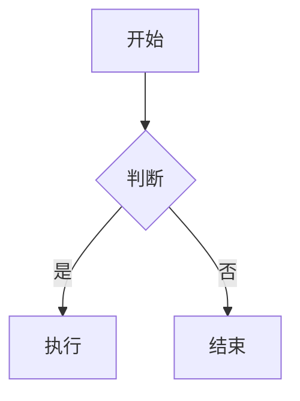

# Markdown 语法

### 标题

使用 `#` 号表示标题层级，`#` 后需加空格，支持 1-6 级标题：

```
# 一级标题
## 二级标题
### 三级标题
#### 四级标题
##### 五级标题
###### 六级标题
```

---

### 文本样式

```
*斜体* 或 _斜体_        → 斜体
**粗体** 或 __粗体__    → 粗体
***粗斜体***            → 粗斜体
~~删除线~~              → 删除线
==高亮==                → 高亮（部分编辑器支持）
```

---

### 段落与换行

- 段落之间用**空一行**分隔
- 行内换行：在行尾加**两个空格**后回车，或使用 `<br>` 标签

---

### 列表

**无序列表**：使用 `-`、`+` 或 `*` 加空格

```
- 项目一
- 项目二
  - 嵌套项目
```

**有序列表**：使用数字加 `.` 和空格

```
1. 第一项
2. 第二项
```

**任务列表**：

```
- [ ] 未完成任务
- [x] 已完成任务
```

---

### 引用

使用 `>` 符号，支持多级嵌套：

```
> 这是一段引用
>> 嵌套引用
```

---

### 代码

**行内代码**：使用单反引号 包裹

```
使用 `print()` 函数输出内容
```

**代码块**：使用三个反引号 包裹，可指定语言实现语法高亮：

````
```python
def hello():
    print("Hello, World!")

```
````

---

### 链接与图片

```
[链接文字](https://www.example.com "可选标题")

```

---

### 表格

使用 `|` 分隔列，`-` 分隔表头与内容，通过 `:` 控制对齐：

```

| 左对齐 | 居中对齐 | 右对齐 |
| :----- | :------: | -----: |
| 单元格 | 单元格   | 单元格 |
```

---

### 分割线

使用三个或以上的 `-`、`*` 或 `_`：

```
---
***
___
```

---

### 转义字符

在特殊符号前加反斜杠 `\` 进行转义：

```
\*这不是斜体\*
\# 这不是标题
```

---

### 脚注

```
这是一段带脚注的文字[^1]

[^1]: 这是脚注内容
```

---

### 进阶功能

- **数学公式**：`$...$` 行内公式，`$$...$$` 块级公式
- **Mermaid 图表**：支持绘制流程图、时序图、甘特图等
- **HTML 混编**：支持嵌入 HTML 标签实现更丰富的样式

---

### 常用编辑器推荐

| 编辑器           | 特点                              |
| ------------- | ------------------------------- |
| **VS Code**   | 搭配 Markdown All in One 等插件，功能强大 |
| **Typora**    | 所见即所得，界面简洁                      |
| **Obsidian**  | 知识管理，支持双向链接                     |
| **Mark Text** | 轻量开源                            |

## Obsidian 扩展语法

Obsidian 在标准 Markdown 之上增加了一套自己的语法，用于双链、嵌入、标注等，以下是最常用的部分。

### 内部链接（双链）

```
[[笔记名]]              → 链接到笔记
[[笔记名|显示文字]]      → 带别名的链接
[[笔记名#标题]]         → 链接到某篇笔记的标题
[[笔记名#^块ID]]        → 链接到某篇笔记的段落
[[#本文标题]]           → 链接到当前笔记的标题
```

- 输入 `[[` 会弹出笔记自动补全列表
- `Ctrl/Cmd + K` 可将选中文字快速转为链接

### 嵌入内容

在链接前加 `!`，即可把对方内容直接显示在当前笔记中：

```
![[笔记名]]             → 嵌入整篇笔记
![[笔记名#标题]]        → 只嵌入某个章节
![[笔记名#^块ID]]       → 只嵌入某个段落
![[图片.png|300]]       → 嵌入图片并指定宽度
![[文档.pdf#page=3]]    → 嵌入 PDF 第 3 页
![[音频.mp3]]           → 嵌入音频播放器
```

### 块引用与块 ID

给任意段落、列表或引用块添加一个唯一 ID（放在块所在行末尾或独立成行）：

```
这段文字可以被精确引用。^my-block
```

之后即可用 `[[笔记名#^my-block]]` 链接或 `![[笔记名#^my-block]]` 嵌入该段落。

### 标注（Callouts）

用 `> [!类型]` 开头创建带样式的提示框：

```
> [!note] 自定义标题
> 这是一条提示内容。

> [!warning]- 默认折叠
> 点击标题才会展开。

> [!tip]+ 默认展开但可折叠
> 内容默认可见。
```

常见类型：

| 类型 | 别名 |
| --- | --- |
| `note` | — |
| `abstract` | `summary`、`tldr` |
| `info` | — |
| `todo` | — |
| `tip` | `hint`、`important` |
| `success` | `check`、`done` |
| `question` | `help`、`faq` |
| `warning` | `caution`、`attention` |
| `failure` | `fail`、`missing` |
| `danger` | `error` |
| `bug` | — |
| `example` | — |
| `quote` | `cite` |

在 `]` 后加 `+` 或 `-` 可控制默认展开/折叠，类型也能通过 CSS 变量自定义颜色。

### 标签

```
#标签
#多级/标签/嵌套
```

写在正文任意位置、以 `#` 开头的词即为标签，与 YAML 属性中的 `tags` 字段等价，标签内不能含空格。

### 属性（Properties）

笔记顶部的 YAML 区域即属性面板：

```yaml
---
title: 笔记标题
date: 2026-10-01
tags:
  - 示例
aliases:
  - 别名一
related: "[[其它笔记]]"
---
```

- 支持文本、数字、日期、复选框、列表等字段类型
- `aliases` 定义别名，让 `[[别名]]` 也能指向本笔记
- 引用笔记的字段建议用引号包裹 wikilink

### 注释

```
%%行内注释，阅读视图中不可见%%

%%
跨行注释
可以写多行
%%
```

### 数学公式

```
行内公式：$E = mc^2$

块级公式：
$$
\int_a^b f(x)\,dx
$$
```

### Mermaid 图表

用 `mermaid` 代码块绘制流程图、时序图、甘特图等：

````

````

### 其它内置增强

- `==高亮==`：Obsidian 原生支持
- ` ```query ` 代码块：在笔记内嵌入搜索查询结果
- 外部链接：直接使用 `[文字](https://...)`，可与双链混用

---

## 常用插件语法

以下为社区插件常用的写作语法，具体以各插件文档为准。

### Dataview

把库中的笔记当作数据库来查询。

**DQL 查询块**：

````
```dataview
TABLE date, tags
FROM #项目
WHERE date >= date(2026-01-01)
SORT date DESC
```
````

- 查询类型：`TABLE`、`LIST`、`TASK`、`CALENDAR`
- `FROM` 指定来源（标签、文件夹、链接）
- `WHERE` 过滤、`SORT` 排序、`GROUP BY` 分组、`LIMIT` 限制数量

**行内字段与行内查询**：

```
项目状态是 [status:: 进行中]

今天是 `= date(today)`
```

**JavaScript 查询**：

````
```dataviewjs
dv.list(dv.pages("#项目").file.link)
```
````

### Templater

用模板快速生成笔记内容，语法写在 `<% %>` 中：

```
<% tp.date.now("YYYY-MM-DD") %>
<% tp.file.title %>
<% tp.file.creation_date("YYYY-MM-DD HH:mm") %>
<% tp.file.include("[[模板片段]]") %>
<% tp.system.prompt("请输入标题") %>
```

### Tasks

在任务列表后追加 emoji 标记，实现截止日期、优先级、重复等管理：

```
- [ ] 写周报 📅 2026-10-05 ⏫
- [ ] 每日锻炼 🔁 every day 📅 2026-10-02
- [x] 完成评审 ✅ 2026-09-30
```

- `📅` 截止日期、`⏳` 计划开始、`🛫` 实际开始、`✅` 完成日期、`➕` 创建日期
- `🔁` 重复规则
- 优先级：`🔺` 最高、`⏫` 高、`🔼` 中、`🔽` 低、`⏬` 最低
- 配合 ` ```tasks ` 查询块可汇总全库任务

### Excalidraw

创建 `.excalidraw` 手绘图，可像普通图片一样嵌入：

```
![[我的绘图.excalidraw]]
```

### Admonition

提供比内置标注更丰富样式的提示框：

````
```ad-note
title: 标题
collapse: open
这是一段提示内容。
```
````

同样支持 `ad-tip`、`ad-warning`、`ad-danger`、`ad-info` 等类型，以及 `ad-` 开头的自定义类型。

### Charts

在笔记中直接生成图表：

````
```chart
type: bar
labels: [一月, 二月, 三月]
series:
  - title: 销量
    data: [10, 20, 30]
```
````

- `type` 支持 `bar`、`line`、`pie`、`radar`、`doughnut` 等
- `labels` 为横轴标签，`series` 为数据系列

### 思维导图（Enhancing Mindmap）

用标题或列表层级生成思维导图，也可使用 `mindmap` 代码块：

````
```mindmap
- 中心主题
  - 分支一
    - 子节点
  - 分支二
```
````

### Advanced Canvas

以 `.canvas` 文件保存可视化白板，本质是 JSON 格式：

```json
{
  "nodes": [
    { "id": "1", "type": "text", "text": "节点内容", "x": 0, "y": 0, "width": 200, "height": 100 }
  ],
  "edges": [
    { "id": "e1", "fromNode": "1", "toNode": "2" }
  ]
}
```

### Advanced Tables

辅助编辑 Markdown 表格：自动对齐、`Tab` 跳转单元格、公式计算等。它本身不引入新语法，只让表格输入更轻松。

### Git

把库作为 Git 仓库进行版本管理与备份，通过命令面板或侧边栏按钮手动/自动提交，笔记内容无需特殊语法。

---

## 相关

- [[双向链接]]
- [[Obsidian 快捷键]]
