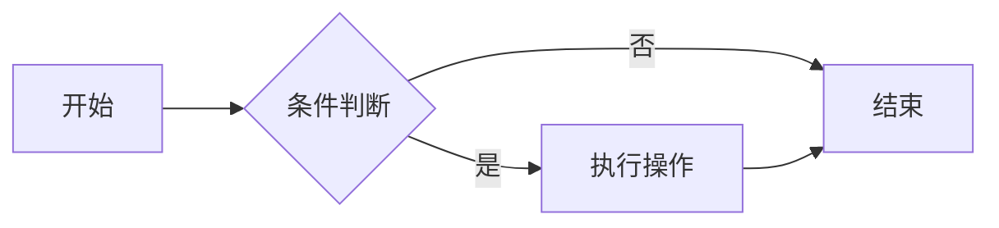
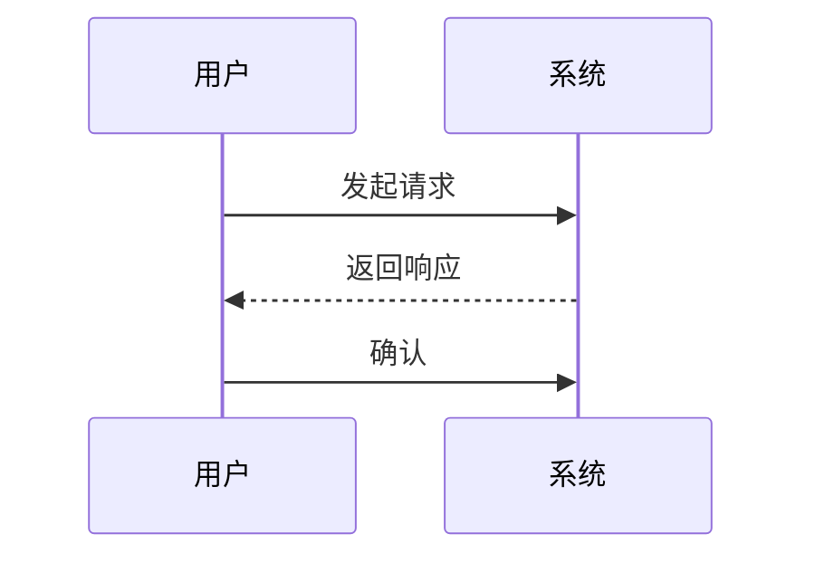
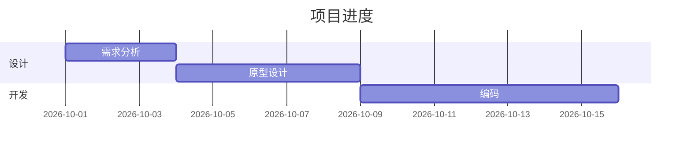
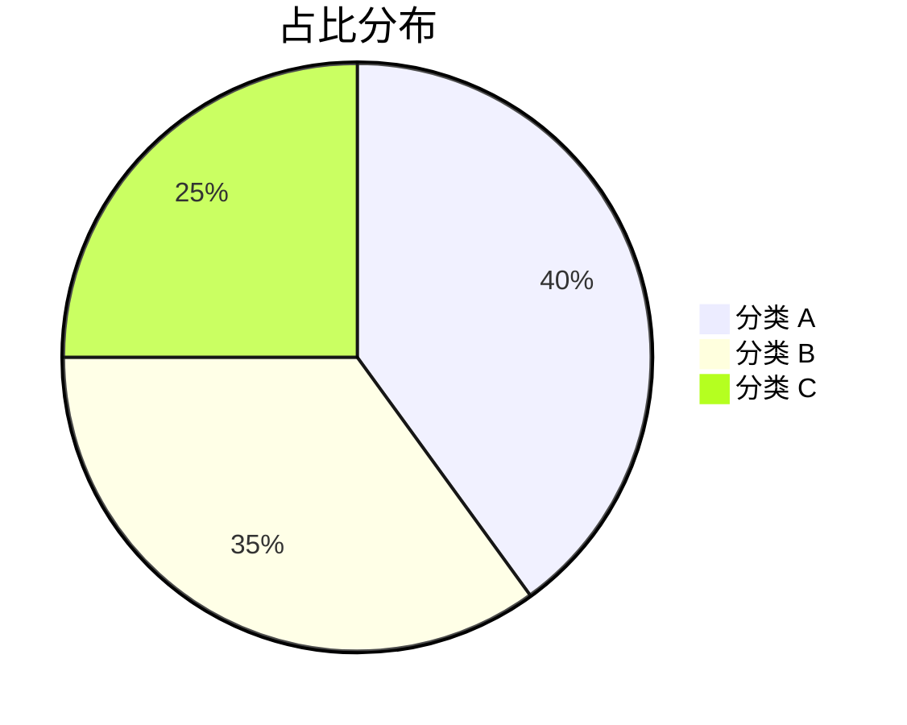
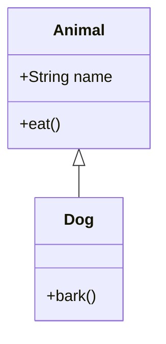
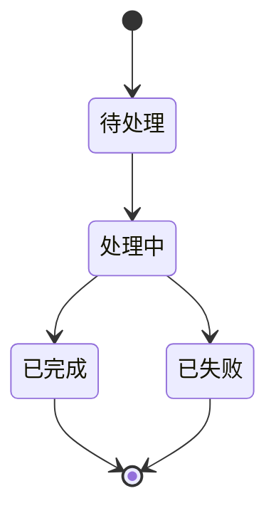

# Obsidian 样式测试

> 用途：集中呈现 Obsidian 支持的各类标记与元素，用于预览和对比主题（含浅色 / 深色模式）的渲染效果。切换主题或安装新主题后打开本笔记即可快速检查。

---

## 1. 标题层级

# 一级标题 Heading 1
## 二级标题 Heading 2
### 三级标题 Heading 3
#### 四级标题 Heading 4
##### 五级标题 Heading 5
###### 六级标题 Heading 6

---

## 2. 文本样式

普通正文文字，用于观察主题的字体、字号、行高与颜色。

- **粗体 Bold**
- *斜体 Italic*
- ***粗斜体 Bold Italic***
- ~~删除线 Strikethrough~~
- ==高亮 Highlight==
- `行内代码 Inline code`
- 组合：**粗体里有 *斜体* 和 `代码`**
- 转义字符：\*这不是斜体\*、\# 这不是标题

HTML 扩展：

- <u>下划线 underline</u>
- <mark>mark 标记</mark>
- 下标 H<sub>2</sub>O、上标 x<sup>2</sup>
- 键盘按键 <kbd>Ctrl</kbd> + <kbd>Shift</kbd> + <kbd>P</kbd>
- 缩写 <abbr title="HyperText Markup Language">HTML</abbr>
- <span style="color: #e91e63;">红色文字</span>、<span style="background: #fff176;">黄色背景</span>、<span style="font-size: 1.5em;">放大字号</span>
- <strong>strong</strong>、<em>em</em>、<del>del</del>、<ins>ins</ins>

---

## 3. 列表

无序列表：

- 第一项
- 第二项
    - 嵌套项 A
    - 嵌套项 B
        - 更深一层
- 第三项

有序列表：

1. 第一项
2. 第二项
    1. 嵌套有序项
    2. 嵌套有序项
3. 第三项

混合列表：

1. 有序项
    - 无序嵌套
    - 无序嵌套
2. 有序项

任务列表：

- [ ] 未完成任务
- [x] 已完成任务
- [/] 进行中
- [-] 已取消
- [>] 已转发
- [?] 待定
- [!] 重要
- [*] 星标
- ["] 引用
- [b] 书签
- [i] 信息
- [S] 储蓄
- [I] 想法
- [p] 优点
- [c] 缺点
- [l] 位置
- [k] 快捷键
- [u] 上升
- [d] 下降

---

## 4. 引用

> 这是一段普通引用。
> 引用可以跨多行。

> 第一层引用
> > 第二层嵌套引用
> > > 第三层嵌套引用

> 引用中的 **粗体**、*斜体* 与 `代码`。

---

## 5. 标注（Callouts）

> [!note] note
> 蓝色 / 默认信息标注。

> [!abstract] abstract
> 摘要。别名：summary、tldr。

> [!info] info
> 信息标注。

> [!todo] todo
> 待办标注。

> [!tip] tip
> 提示。别名：hint、important。

> [!success] success
> 成功。别名：check、done。

> [!question] question
> 问题。别名：help、faq。

> [!warning] warning
> 警告。别名：caution、attention。

> [!failure] failure
> 失败。别名：fail、missing。

> [!danger] danger
> 危险。别名：error。

> [!bug] bug
> Bug 标注。

> [!example] example
> 示例标注。

> [!quote] quote
> 引用标注。别名：cite。

折叠与嵌套：

> [!faq]- 默认折叠
> 点击标题才会展开的内容。

> [!faq]+ 默认展开但可折叠
> 内容默认可见，可点击收起。

> [!question] 外层标注
> > [!note] 内层标注
> > 嵌套在标注里的标注。

> [!tip] 无正文标题
> 只有内容，不写自定义标题时显示类型名称。

> [!warning] 自定义标题与 Markdown
> 支持 **粗体**、*斜体*、`代码`、[[Markdown语法|内部链接]]。
> - 列表项
> - 列表项

---

## 6. 代码

行内代码：使用 `print("Hello, World!")` 输出。

无语言代码块：

```
普通的代码块，无语法高亮。
第二行内容。
```

带语法高亮：

```python
def fibonacci(n: int) -> int:
    """返回第 n 个斐波那契数。"""
    a, b = 0, 1
    for _ in range(n):
        a, b = b, a + b
    return a

print(fibonacci(10))
```

```javascript
const greet = (name) => `Hello, ${name}!`;
console.log(greet("Obsidian"));
```

```css
.theme-dark {
  --background-primary: #1e1e1e;
  --text-normal: #dcddde;
}
```

```json
{
  "name": "obsidian",
  "version": "1.0.0",
  "keywords": ["markdown", "notes"]
}
```

带标题的代码块：

```python title="demo.py"
# 代码块标题语法：```语言 title="文件名"
print("带标题的代码块")
```

行号代码块（部分主题 / 插件支持）：

```python ln:true
# 依赖主题或插件对行号的支持
for i in range(3):
    print(i)
```

---

## 7. 表格

| 左对齐 | 居中对齐 | 右对齐 | 默认 |
| :----- | :------: | -----: | ---- |
| 单元格 | 单元格 | 单元格 | 单元格 |
| **粗体** | *斜体* | `代码` | [[Markdown语法\|链接]] |
| 较长的一段文字用于观察换行 | 中 | 123456 | 普通 |

带内联元素的表格：

| 元素 | 示例 | 说明 |
| --- | --- | --- |
| 高亮 | ==高亮== | 背景色 |
| 删除 | ~~删除~~ | 中划线 |
| 代码 | `code` | 等宽字体 |

---

## 8. 分割线

上方内容。

---

下方内容（三个连字符）。

***

再下方内容（三个星号）。

___

再下方内容（三个下划线）。

---

## 9. 链接

- 内部链接：[[Markdown语法]]
- 带别名：[[Markdown语法|Markdown 语法笔记]]
- 指向标题：[[Markdown语法#标注（Callouts）]]
- 指向块：[[Markdown语法#^my-block]]
- 指向本笔记标题：[[#1. 标题层级]]
- 未创建的链接（悬空链接，用于测试未解析样式）：[[一篇尚不存在的笔记]]
- 外部链接：[Obsidian 官网](https://obsidian.md)
- 带标题的外部链接：[Obsidian 帮助](https://help.obsidian.md "官方帮助文档")
- 自动链接：<https://obsidian.md>
- 裸链接：https://obsidian.md
- 邮箱链接：<mailto:someone@example.com>

---

## 10. 嵌入（Embeds）

嵌入整篇笔记（此处用注释关闭实际嵌入，避免内容过长）：

`![[Markdown语法]]`

嵌入某篇笔记的标题：

`![[Markdown语法#标注（Callouts）]]`

嵌入图片（实际生效）：

![[Pasted image 20260830211748.png|200]]

其他嵌入语法（不实际生效，仅展示）：

- `![[图片.png|300]]` 指定宽度
- `![[文档.pdf#page=3]]` 嵌入 PDF 指定页
- `![[音频.mp3]]` 音频播放器
- `![[视频.mp4]]` 视频播放器
- `![[笔记#^block-id]]` 嵌入段落

---

## 11. 标签

行内标签：#Obsidian #测试/样式 #测试/主题

嵌套标签可以形成层级：#知识/编辑 #知识/编程/Python

---

## 12. 数学公式

行内公式：质能方程 $E = mc^2$，以及 $\alpha + \beta = \gamma$。

块级公式：

$$
\int_0^\infty e^{-x^2}\,dx = \frac{\sqrt{\pi}}{2}
$$

多行对齐公式：

$$
\begin{aligned}
(a + b)^2 &= a^2 + 2ab + b^2 \\
(a - b)^2 &= a^2 - 2ab + b^2
\end{aligned}
$$

矩阵与分数：

$$
\mathbf{A} = \begin{pmatrix} a & b \\ c & d \end{pmatrix}, \qquad
f(x) = \frac{1}{\sigma\sqrt{2\pi}} e^{-\frac{(x-\mu)^2}{2\sigma^2}}
$$

---

## 13. Mermaid 图表

流程图：



时序图：



甘特图：



饼图：



类图：



状态图：



---

## 14. 脚注

这是一段带脚注的文字[^1]，这里还有第二个脚注[^note]。

[^1]: 这是第一个脚注的内容。
[^note]: 这是具名脚注的内容，支持 **Markdown** 格式。

---

## 15. 注释

行内注释：%%这段文字在阅读视图中不可见%%，注释两侧仍有正常文字。

块注释：

%%
这是一段块注释。
在阅读视图中不会显示。
可以包含任意内容。
%%

---

## 16. 块 ID 与块引用

下面这段文字带有块 ID，可以被其他笔记引用或嵌入。^my-block

- 列表也可以拥有块 ID。^list-block
- 第二项。

引用块 ID 的语法：`[[Obsidian 样式测试#^my-block]]`。

---

## 17. HTML 元素

<details>
<summary>点击展开 / 折叠（原生 details）</summary>

这里是折叠区域内的内容，可以放正文、列表等。

- 项目一
- 项目二

</details>

<p align="center">使用 HTML 实现居中段落</p>

<center>使用 center 标签居中</center>

<blockquote>使用 HTML blockquote 的引用</blockquote>

<hr>

<dl>
  <dt>术语</dt>
  <dd>术语的解释（定义列表）。</dd>
</dl>

---

## 18. 综合示例

> [!tip] 嵌套综合
> 在标注中组合多种元素：
>
> 1. 有序列表项
> 2. 带 **粗体** 的项
>
> | 列 A | 列 B |
> | --- | --- |
> | 1 | 2 |
>
> ```python
> print("标注里的代码块")
> ```
>
> ---
>
> 结束。

---

## 检查清单

- [ ] 浅色模式下的标题与正文对比度
- [ ] 深色模式下的标题与正文对比度
- [ ] 链接与未解析链接的颜色区分
- [ ] 高亮、加粗、斜体的可见度
- [ ] 各种 Callout 的图标与配色
- [ ] 代码块语法高亮
- [ ] 表格边框与斑马纹
- [ ] 任务列表复选框样式
- [ ] 数学公式与 Mermaid 渲染
- [ ] 标签与属性（Properties）面板样式
